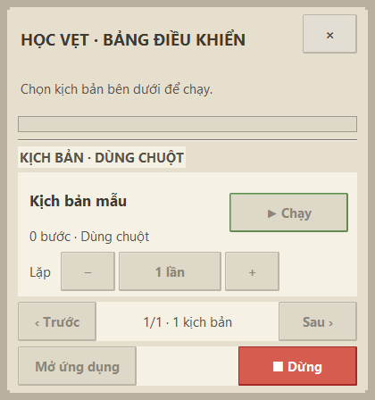
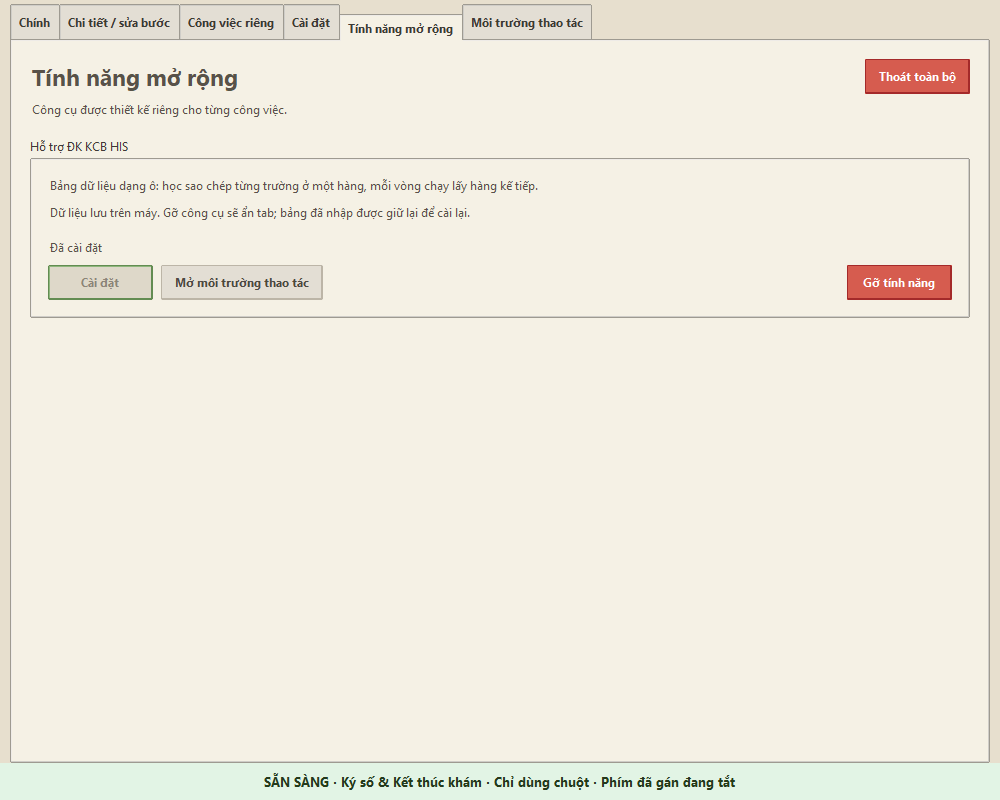
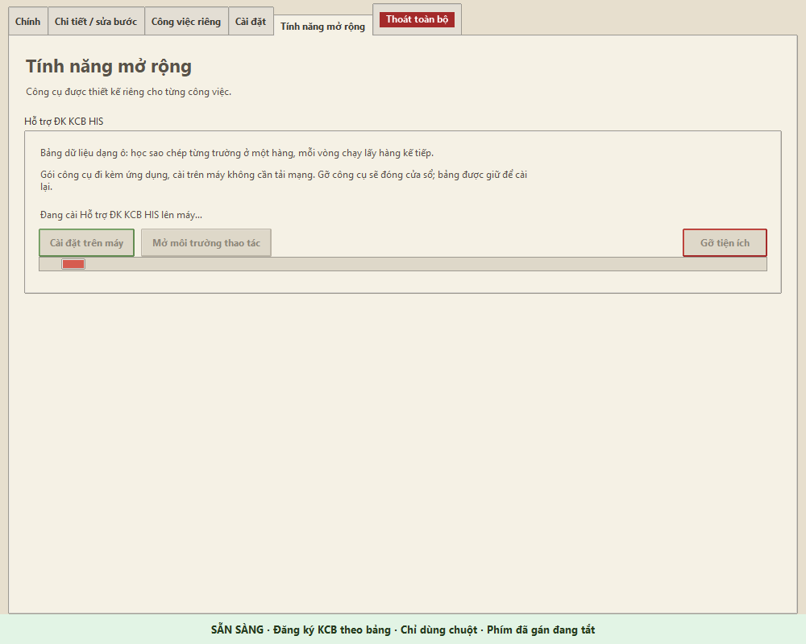
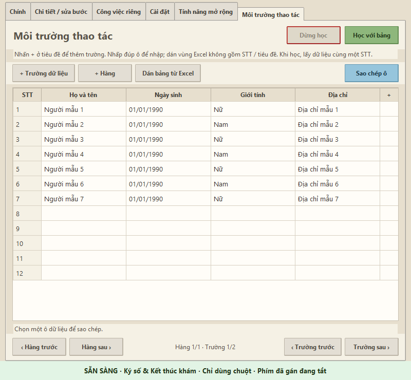
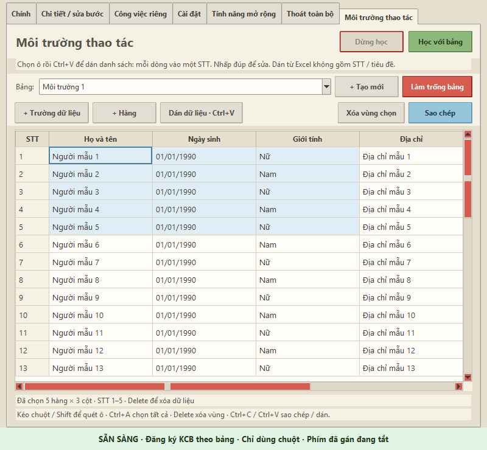
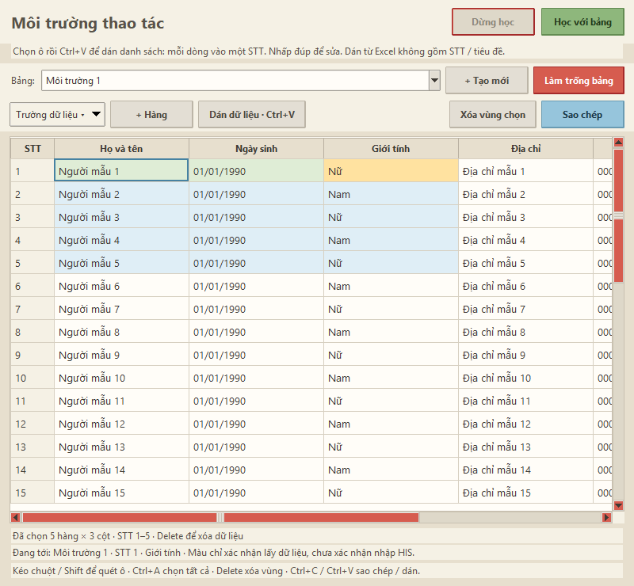
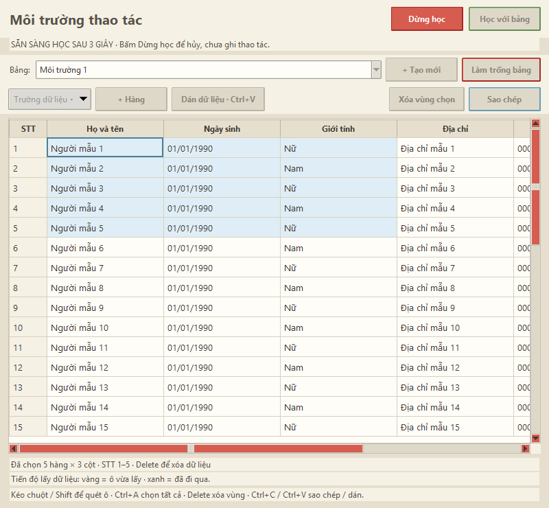
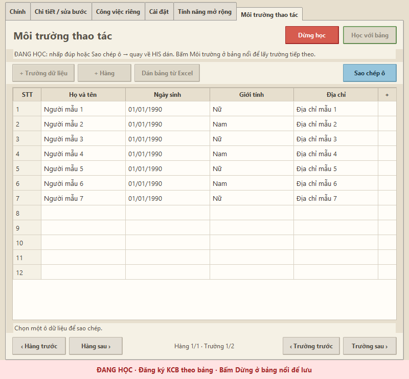

# Học Vẹt · v0.20.3

Trợ lý ghi và phát lại thao tác chuột / bàn phím trên Windows, dành cho công việc văn phòng và phần mềm HIS.

**Tác giả:** Nhật Nam ([@UIBreaker](https://github.com/UIBreaker)) · **Giấy phép:** [MIT](LICENSE)

## Có gì mới trong 0.20.3

- Chọn rõ kiểu dán **văn bản một ô** hoặc **ngày → ba ô HIS** cho từng cột; lưu cùng bảng.
- Sửa dán ngày liên tiếp bằng Ctrl+V và khi phát lại; giữ nguyên ô phụ thứ tư.
- Chặn kịch bản cũ chưa học bước dán ba ô, báo cần học lại trước khi chạy.
- Sửa bố cục bảng điều khiển để các nút dưới luôn hiện, kể cả khi thu nhỏ hoặc đổi DPI.

Chi tiết tại [ghi chú phát hành](RELEASE_NOTES.md).

## Tải và chạy

Tải **HocVet.exe** hoặc **HocVet-v0.20.3-Windows.zip** tại [bản phát hành 0.20.3](https://github.com/UIBreaker/HocVet/releases/tag/v0.20.3); **SHA256SUMS.txt** dùng để kiểm tra file tải về. Xem bản mới nhất tại [GitHub Releases](https://github.com/UIBreaker/HocVet/releases/latest). Giải nén ZIP rồi chạy **Học Vẹt.exe**, hoặc chạy trực tiếp **HocVet.exe**; không cần cài Python. Chế độ Web riêng cần Microsoft Edge đã cài. Giao diện hiển thị tên **Học Vẹt**; kho mã tại **UIBreaker/HocVet**.

Đóng phiên bản cũ trước khi mở EXE mới. Dữ liệu và cài đặt được giữ trong `%LOCALAPPDATA%\HocVet`; không xóa thư mục này khi nâng cấp.

Khi nâng cấp từ Smart Operation, đặt ứng dụng cạnh `scripts_library.json` cũ trước lần mở đầu tiên. Nếu chạy từ thư mục `dist`, ứng dụng cũng kiểm tra thư mục cha. File cũ được giữ nguyên. Từ lần sau có thể thay / di chuyển file ứng dụng mà vẫn giữ thư viện.


## Sử dụng nhanh

1. Chọn kịch bản (hoặc **+ Tạo mới**). Ở chế độ chuột mặc định, bấm **Học thao tác**; ở chế độ phím, nhấn **F8**. Chờ đếm ngược **3–2–1** và thông báo **Đang học** rồi thao tác trên phần mềm đích. Bấm **Dừng** trên bảng nổi ở chế độ chuột; ở chế độ phím, nhấn lại **F8** hoặc phím **Dừng học** đã gán. Thông báo **Đã dừng & lưu thành công** xuất hiện sau khi lưu xong. Cú bấm Dừng không bị ghi vào kịch bản.
2. Chọn **Chạy** trên màn hình chính hoặc từng dòng ở bảng nổi. Nếu bật chế độ phím, có thể dùng phím riêng của kịch bản (mặc định mẫu: **F9**). Ở chế độ phím, nhấn **Esc** để dừng khẩn cấp; ở chế độ chuột, bấm **Dừng** trên bảng nổi.
3. Mở **Chi tiết / sửa bước**, chọn một dòng, dùng **+ Chờ cửa sổ** / **+ Chờ ảnh / nút** để chèn điều kiện trước dòng đó; không chọn dòng sẽ thêm ở cuối. **Sửa điều kiện** để đổi ảnh hoặc thời hạn.
4. **Xuất file** tạo một file `.hocvet` nén gồm kịch bản, cài đặt phát và ảnh mẫu. Người nhận dùng **Nhập file** để thêm thành kịch bản mới. Không ghi đè kịch bản đang có; vẫn đọc được JSON cũ.
5. Mở **Hướng dẫn** ngay trong ứng dụng để xem cách lưu, chia sẻ, gán phím và kiểm tra ảnh.

Tab **Chính** điều chỉnh tốc độ từ **1× đến 10×**. Tab **Chi tiết / sửa bước** hiển thị **12 bước/trang**; tab **Cài đặt** hiển thị **6 lệnh/trang**. Chuyển trang để xem đủ các bước và phím tắt.


Các phím trên là mặc định, có thể đổi trong Cài đặt.

## Chọn và xóa kịch bản

Ô chọn kịch bản hiển thị rõ **tên · Phím chạy**, có số bước và tổng số kịch bản bên dưới. Nút đỏ **Xóa kịch bản** nằm cạnh **Tạo mới**, hỏi xác nhận trước khi xóa và chỉ dùng khi đã dừng học / chạy. Thư viện giữ ít nhất một kịch bản; hãy tạo kịch bản mới trước khi xóa kịch bản cuối cùng.

Nếu không lưu được thư viện, ứng dụng báo lỗi và giữ nguyên kịch bản. Nút xóa dùng chung lệnh với phím tắt **Xóa kịch bản** trong Cài đặt.


## Bảng nổi khi chạy nền (v0.15)

Khi bấm **Chạy**, Học Vẹt thu vào khay trước rồi bắt đầu phát sau khoảng 0,2 giây để cửa sổ công việc nhận lại tiêu điểm. Bảng nổi không lấy tiêu điểm; phần trên là tiến trình, phần dưới có tên, số bước và nút **Chạy** cho từng kịch bản màn hình. Chọn **Trước / Sau** hoặc lăn chuột để chuyển trang. Bảng giữ nguyên khi hoàn tất, sẵn sàng cho lượt tiếp theo. Kịch bản rỗng / bị tắt không chạy được.

**Đóng / mở bảng:** bấm × trên bảng để ẩn; công việc vẫn chạy. Mở lại bằng **Bảng điều khiển** trên màn hình chính hoặc menu **Bảng điều khiển · Mở / ẩn** trong khay hệ thống. Thông báo tiến độ không tự bật lại bảng đã ẩn. Có thể dừng bằng menu khay; bắt đầu lượt học mới sẽ hiển thị đếm ngược. Vị trí được giữ khi ẩn / mở trong cùng phiên ứng dụng.

**Cài đặt → Kích hoạt kịch bản** có hai lựa chọn:

- **Bấm chuột ở bảng nổi** (mặc định): tắt toàn bộ phím đã gán, kể cả Dừng khẩn cấp và phím riêng của kịch bản. Gõ số từng gán để dừng sẽ không ngắt công việc. Bấm **Học thao tác** trên màn hình chính để học, rồi **Dừng** ở bảng nổi để lưu. Không xóa cấu hình phím đã gán.
- **Dùng phím đã gán**: bật các phím đó và khóa nút Học / Chạy / Dừng bằng chuột ở màn hình chính, bảng nổi và tab Công việc. Phím **Dừng khẩn cấp** chỉ hoạt động trong chế độ này.

Kéo tiêu đề bảng để đổi vị trí theo ý muốn, kể cả khi đang chạy. Khi bảng di chuyển, vùng nút Dừng và vùng nhận chuột được cập nhật theo vị trí mới. Các nút Chạy / chuyển trang / Mở ứng dụng bị khóa trong lúc chạy; **Dừng** bằng chuột chỉ dùng được ở chế độ chuột. Bấm **Mở ứng dụng** khi đã dừng để trở về màn hình chính. Khi cài HIS, bảng có thêm **Mở môi trường HIS**, dùng khi rảnh hoặc đang học; trong lúc chạy nút này khóa để giữ tiêu điểm cho phần mềm đích.

Bấm vào bảng không được ghi thành thao tác. Khi phát macro màn hình, bảng vẫn hiển thị nhưng nhận diện chuột xuyên qua; cú bấm / cuộn được gửi tới cửa sổ bên dưới tại đúng tọa độ. Bộ lọc nhận chuột thật để kéo tiêu đề, ẩn bảng và bấm Dừng ở chế độ chuột; thao tác do kịch bản phát không kích hoạt các nút này. Các cú bấm tay khác trên bảng trong lúc phát được chặn để không bấm nhầm xuống cửa sổ bên dưới. Sau khi hàng đợi chuột hoàn tất, bảng nhận chuột trở lại. Kiểm tra bàn phím vẫn dừng nếu cửa sổ Học Vẹt bất ngờ nhận tiêu điểm. Macro màn hình vẫn dùng chuột thật của Windows; dùng tab Công việc riêng khi cần nhập liệu độc lập.


## Số lần lặp và kích thước bảng (v0.16)

Dưới mỗi kịch bản có **−**, **số lần**, **+**. Bấm −/+ để đổi từng đơn vị hoặc bấm số để nhập trực tiếp. Nhập **0** nếu muốn chạy liên tục đến khi Dừng. Giá trị được lưu riêng cho đúng kịch bản và đồng bộ với ô Lặp lại trên màn hình chính; nếu lưu thất bại ứng dụng giữ số cũ và báo lỗi.

Kéo bất kỳ cạnh hoặc góc của bảng nổi để đổi kích thước. Bảng hẹp / thấp sẽ hiển thị ít kịch bản hơn trên một trang; bảng cao sẽ hiển thị nhiều hơn. Có giới hạn nhỏ nhất để giữ nút Dừng và điều hướng đọc được, và giới hạn theo vùng màn hình làm việc. Kích thước được lưu khi thả chuột, không ghi file liên tục khi kéo.

Chỉ chỉnh lặp và kích thước khi đang dừng; trong lúc học / chạy các điều khiển này được khóa để giữ ổn định vùng bấm xuyên bảng. Cả chế độ phím và chuột đều có thể chỉnh cấu hình lúc rảnh; việc kích hoạt kịch bản vẫn tuân theo chế độ đã chọn.


Bảng tự dành chỗ cho hàng nút dưới và điều chỉnh số thẻ kịch bản theo chiều cao còn lại, cả khi đang chạy hoặc đổi DPI.




## Cài đặt phím tắt

Gán phím đơn (F6, K) hoặc tổ hợp (Ctrl+Shift+K) cho các nút, từng mức tốc độ, tùy chọn, thao tác khay và các nút Lưu / Hủy / Chụp ảnh trong hộp thoại.

Các phím đã gán chỉ hoạt động khi chọn **Cài đặt → Kích hoạt kịch bản → Dùng phím đã gán**. Ở chế độ chuột mặc định, mọi phím gán đều tắt, kể cả **Esc / Dừng khẩn cấp**; dùng nút **Dừng** trên bảng nổi. Đổi chế độ không xóa cấu hình phím.

- Gõ tên phím hoặc bấm **Ghi phím**, rồi chọn **Lưu cài đặt**.
- Chọn **Trong ứng dụng** hoặc **Toàn cục**. Trong chế độ phím, phím toàn cục dùng được khi thu vào khay; Học và Dừng khẩn cấp luôn ở phạm vi toàn cục.
- **Dừng học** luôn là toàn cục; gán phím `2` sẽ dừng được khi đang thao tác ở phần mềm khác. Cài đặt cũ ở phạm vi Trong ứng dụng được chuyển tự động cho lệnh này. Hàng số và bàn phím số đều được hỗ trợ.
- Bỏ trống để bỏ gán, trừ Học và Dừng khẩn cấp. Các nút trong hộp thoại dùng phím theo ngữ cảnh. Khi gán phím, lắng nghe toàn cục tạm ngừng.
- Báo lỗi khi phím trùng / chồng tổ hợp với lệnh hoặc kịch bản khác, ví dụ F6 và Ctrl+F6. Phím chữ đơn không lấy mất ký tự đang nhập trong ô văn bản.
- Chọn **Khôi phục phím mặc định** rồi Lưu để đặt lại. Cài đặt được giữ qua cập nhật.


## Dữ liệu và cập nhật

Thư viện và cài đặt lưu riêng tại `%LOCALAPPDATA%\HocVet\scripts_library.json`, tách khỏi file ứng dụng. Có thể mở thư mục này từ menu trong ứng dụng. Không xóa thư mục dữ liệu khi cập nhật.

Lưu qua file tạm rồi thay thế; `.bak` giữ lần lưu trước và được đọc khi file chính hỏng. Để chuyển máy, xuất từng kịch bản hoặc sao lưu cả thư mục dữ liệu. Gói phát hành không chứa thư viện cá nhân.

## Độ ổn định và giao diện

- **Chờ cửa sổ:** chờ cửa sổ phía trước có tiêu đề chứa nội dung đã nhập.
- **Chờ ảnh:** chụp một vùng nhỏ, ổn định; mặc định cho phép 2% pixel khác màu rõ rệt. Ảnh được so sánh ở đúng tọa độ đã chụp, không tìm ở vị trí khác. Giữ cùng bố cục, vị trí cửa sổ, độ phân giải và DPI khi chạy / chia sẻ.
- **Hết thời hạn:** kịch bản dừng và báo lỗi trước thao tác tiếp theo. Tốc độ phát không rút ngắn thời hạn chờ.
- **Tiếng Việt:** ghi phím vật lý, bỏ qua phím do bộ gõ tự sinh. Giữ cùng bộ gõ Unicode, Telex/VNI, bố cục bàn phím và Caps Lock khi học / chạy. Kịch bản cũ bị lặp dấu cần học lại.
- **Mượt hơn:** không dựng lại danh sách cho từng sự kiện nhập; đếm số thao tác theo đợt và giới hạn tần suất cập nhật tiến độ. Kịch bản dài xem/sửa theo trang 12 bước, vẫn giữ đầy đủ mọi thao tác.
- **Giao diện thống nhất:** màu kem, nút theo vai trò, ô nhập và hộp thoại dùng chung kiểu hiển thị. Trạng thái luôn hiện ở cuối cửa sổ; chia tab và điều chỉnh theo DPI, hỗ trợ Tab / Enter / Space. Hộp chọn file sử dụng giao diện Windows.

Kịch bản có thể chứa nội dung đã gõ và ảnh chụp màn hình; kiểm tra trước khi chia sẻ. Chưa xác minh trên mọi phần mềm HIS / bộ gõ; thử kịch bản trên dữ liệu mẫu trước khi dùng thực tế.

## Hỗ trợ ĐK KCB HIS (v0.17)

1. Mở tab **Tính năng mở rộng** cạnh Cài đặt → **Cài đặt** công cụ **Hỗ trợ ĐK KCB HIS**. Bấm **Mở môi trường thao tác** để mở cửa sổ riêng. Không thêm tab mới vào màn hình chính.
2. Bấm **+** ở tiêu đề (hoặc **Trường dữ liệu → Thêm trường**) để thêm Họ và tên, Ngày sinh, Giới tính, Địa chỉ, CCCD, SĐT… STT là số hàng tự động, không nhập / đổi thành trường khác. Nhấp đúp ô để nhập, Enter để lưu, Esc hủy; phím mũi tên để chuyển ô. Có thể chọn ô bắt đầu rồi **Dán dữ liệu · Ctrl+V**: chỉ chọn dữ liệu, không gồm STT hoặc dòng tiêu đề. Thêm đủ trường trước khi dán. Dữ liệu được giữ dạng văn bản, không tự chuyển ngày hay bỏ số 0 đầu.
3. Chọn / tạo kịch bản, mở Môi trường thao tác rồi **Học với bảng** ở chế độ chuột. Nếu dùng chế độ phím, nhấn phím Học đã gán (mặc định F8). Chờ đếm ngược xong.
4. Nhấp đúp ô hoặc bấm **Sao chép** ở STT 1. Ứng dụng ghi một bước lấy trường, thu cửa sổ bảng để bạn quay về HIS, bấm đúng ô đích và dán. Dùng nút **Mở môi trường HIS** trên bảng điều khiển để trở về lấy trường tiếp theo **cùng STT 1**. Các cú bấm / Ctrl+C trong bảng không bị lưu thành tọa độ; thao tác dán, chọn ô và xử lý bên HIS vẫn được học bình thường.
5. **Dừng học** trong cửa sổ môi trường, nút **Dừng** trên bảng nổi hoặc phím dừng theo chế độ để lưu. Chọn số lần chạy rồi Chạy: học ở STT 1 và chạy 7 lần sẽ lấy lần lượt STT 1–7. Nếu học bắt đầu STT 3 thì các vòng lấy STT 3, 4, 5…
6. Kịch bản dùng bảng chọn **0 lần** sẽ chạy đến hàng cuối có dữ liệu rồi kết thúc. Các hàng trống hoàn toàn ở cuối được bỏ qua khi tính số hàng. Thiếu hàng, thiếu trường hoặc ô bắt buộc trống sẽ được báo **trước thao tác đầu tiên**; không dùng lại clipboard của hàng trước. Một kịch bản phải học tất cả trường từ cùng một STT để tránh trộn hàng.

Chọn ô cần bắt đầu rồi **Ctrl+V** hoặc **Dán dữ liệu**. Ví dụ sao chép 10 tên, mỗi tên một dòng, chọn ô Họ và tên tại STT 1 rồi dán: dữ liệu điền lần lượt STT 1–10. Có thể dán một cột vào giữa bảng mà giữ các cột khác. Thanh cuộn dọc / con lăn để xem hàng, thanh ngang / Shift + con lăn để xem cột; không cần chuyển trang. Tiêu đề giữ nguyên khi cuộn dọc. Đang học chỉ sao chép, không sửa dữ liệu. Khi phát, bảng có thể đóng; ứng dụng dùng bản chụp dữ liệu cho lượt chạy đó.

**Tùy chỉnh trường:** chọn tiêu đề / ô trong cột rồi mở **Trường dữ liệu ▾**, hoặc nhấp chuột phải. Có thể thêm, đổi tên, chuyển trái / phải, xóa cột sau xác nhận. Đổi tên / vị trí giữ mã trường và dữ liệu. Xóa cột xóa dữ liệu cột đó, giữ cột khác và bảng khác; kịch bản dùng trường bị xóa phải học lại bước lấy dữ liệu, không tự chuyển sang bảng khác. Không chỉnh trường khi đang học / chạy.

**Đếm ngược và tiến độ:** Học với bảng luôn có 3–2–1, có thể bấm Dừng học để hủy; chưa ghi trước khi hết đếm ngược. Khi chạy, cửa sổ chính thu vào khay và cửa sổ môi trường ẩn để nhường thao tác cho phần mềm đích; bảng nổi hiển thị STT / tên trường vừa lấy. Khi mở lại bảng, màu vàng là ô vừa lấy / dừng tới, xanh là các ô đã đi qua; chạy thành công chuyển các ô đã lấy sang xanh. Bắt đầu lượt mới hoặc sửa dữ liệu sẽ xóa dấu màu cũ. Màu chỉ xác nhận sao chép dữ liệu, không xác nhận kết quả nhập / đăng ký HIS.

**Nhiều môi trường:** bấm **+ Tạo mới**, đặt tên rồi thêm trường / dán dữ liệu. Chọn bảng cũ bằng danh sách **Bảng**. Mỗi môi trường có dữ liệu riêng. Kịch bản đã học vẫn lấy bảng chứa các trường đã học dù bạn đang xem bảng khác; kịch bản chia sẻ từ máy khác sẽ ghép tên trường vào bảng đang chọn khi không có mã trường gốc. Khi học không chuyển bảng.

**Xóa bảng:** chọn môi trường rồi bấm **Xóa bảng**, kiểm tra tên và xác nhận. Thao tác xóa cả trường và dữ liệu của bảng đó, giữ các bảng khác; kịch bản tham chiếu bảng đã xóa sẽ bị chặn. Nếu xóa bảng cuối, ứng dụng giữ một môi trường trống.

**Quét chọn và xóa:** kéo chuột từ ô đầu đến ô cuối, Shift + bấm hoặc Shift + mũi tên để mở rộng vùng. Kéo ra mép bảng sẽ tự cuộn. Ctrl+A chọn toàn bộ dữ liệu; Ctrl+C sao chép vùng theo hàng / cột để dán ra Excel. Delete hoặc **Xóa vùng chọn** chỉ xóa nội dung, giữ STT và trường. **Làm trống dữ liệu** xóa dữ liệu bảng đang chọn sau khi xác nhận, giữ cột và các bảng khác. **Xóa bảng** xóa cả bảng, các cột và dữ liệu sau xác nhận; kịch bản dùng bảng đã xóa sẽ báo cần học lại. Xóa bảng cuối sẽ tạo một bảng trống. Các thao tác tạo / đổi / xóa bị khóa khi học hoặc chạy.

**Ngày tháng tách ô HIS:** chọn một ô của cột ngày, đặt **Kiểu dán** thành **Ngày / tháng / năm → 3 ô HIS** ở hàng tùy chọn của cột (hoặc qua menu **Trường dữ liệu → Kiểu dán: ngày → 3 ô HIS (dd/mm/yyyy)**). Tiêu đề cột hiện **Ngày → 3 ô**. Nhập ngày đầy đủ như `19/08/1987`, sao chép ô như bình thường, chọn **ô ngày đầu tiên** trên HIS rồi **Ctrl+V và nhả Ctrl**: phần mềm thay nội dung lần lượt ba ô ngày, tháng, năm bằng Tab; ô phụ thứ tư được giữ nguyên. Chế độ chờ dán có hiệu lực 60 giây và hủy nếu nội dung clipboard đổi; việc ghi lại cùng nội dung không hủy chế độ này. Khi học, bước **Dán ngày → 3 ô HIS** được ghi khi bạn dán; mỗi vòng chạy lấy ngày của hàng kế tiếp và kiểm tra ngày hợp lệ trước khi bắt đầu. Kịch bản cũ cần học lại bước này để dùng kiểu dán mới. Với ngày nằm trong một textbox duy nhất, giữ **Kiểu dán: văn bản một ô**. Tính năng yêu cầu ba ô liền nhau theo thứ tự Tab ngày → tháng → năm; đã kiểm tra trên trang HIS giả lập, chưa kiểm tra trên HIS thực tế.

Dữ liệu và trạng thái cài đặt ở `%LOCALAPPDATA%\HocVet\his_environment.json`, có bản `.bak` khi lưu. **Gỡ tiện ích** có xác nhận, đóng cửa sổ môi trường và bỏ nút mở trên bảng điều khiển, giữ dữ liệu để cài lại. Thay EXE không xóa bảng. Các bước lấy dữ liệu trong file `.hocvet` chỉ lưu tham chiếu tên / mã trường và STT bắt đầu, không tự nhúng các hàng trong bảng; máy nhận cần cài tiện ích, tạo trường cùng tên và nhập bảng riêng. Các bước phím hoặc ảnh khác vẫn có thể chứa nội dung đã học, hãy kiểm tra trước khi chia sẻ. Kịch bản cũ sao chép theo tọa độ cần học lại các bước lấy dữ liệu trong cửa sổ môi trường.

**Thoát toàn bộ** là tab riêng màu đỏ, luôn nằm cuối cùng bên phải trên thanh tab. Chọn tab này để thoát; menu cũng có cùng lệnh. Lệnh này dừng / lưu kịch bản, đóng công việc riêng và thoát hẳn. Nếu lưu thất bại sẽ báo lỗi thay vì báo đã lưu. Nút đóng [X] vẫn theo tùy chọn thu vào khay trong Cài đặt.

Đã kiểm thử bằng dữ liệu mẫu và thao tác HIS mô phỏng, chưa xác minh đăng ký thực tế trên phần mềm HIS. Công cụ hỗ trợ nhập liệu theo kịch bản, không kết nối trực tiếp tới cơ sở dữ liệu HIS.

Cài / gỡ dùng gói tiện ích đi kèm ứng dụng. Trong lúc xử lý, các nút bị khóa và thanh tiến trình hiển thị trạng thái; chờ thông báo hoàn tất rồi mở môi trường. Gỡ có xác nhận và giữ dữ liệu để cài lại.















## Công việc riêng (v0.14)

Các tab **Chính**, **Chi tiết / sửa bước**, **Công việc riêng**, **Cài đặt**, **Tính năng mở rộng** không có thanh cuộn. Chi tiết chia 12 bước/trang, cài đặt chia 6 lệnh/trang. Thanh tốc độ hỗ trợ mọi mức nguyên từ **1× đến 10×**. Chỉ dùng thông báo nổi của Học Vẹt, có thanh tiến độ khi chạy; không gửi thông báo Windows.

Trong **Công việc riêng**, chọn loại phiên rồi bấm **Mở phiên**. Ở chế độ chuột, bấm **Học trong tab**, thao tác trên ảnh xem trước bằng chuột đỏ, nhập tiếng Việt ở ô **Nhập chữ** rồi **Gửi vào phiên**. **Dừng** sẽ tự lưu; chọn **Chạy công việc** để phát lại. Có thể đổi tab, dùng ứng dụng khác hoặc thu Học Vẹt vào khay trong lúc chạy. Ở chế độ phím, các nút Học / Chạy / Dừng bị khóa bằng chuột; gán phím tương ứng trong Cài đặt để sử dụng. Phím Dừng học / Khẩn cấp cũng dừng công việc riêng khi đang ở chế độ phím.

- **Web riêng:** cần Microsoft Edge đã cài. Dùng trình duyệt headless với hồ sơ riêng `%LOCALAPPDATA%\HocVet\web-session`; đăng nhập qua ảnh xem trước nếu cần. Không mở hồ sơ Edge cá nhân. Chuột và phím chỉ gửi vào phiên này. Trang dùng xác thực đặc biệt, tải file hoặc cửa sổ mới chưa được hỗ trợ đầy đủ.
- **Windows / HIS tương thích:** chọn một cửa sổ đang mở và giữ nguyên kích thước khi chạy. Hỗ trợ ô nhập Edit/RichEdit, một số WinForms và nút Windows chuẩn. Có thể dùng ứng dụng khác nhưng không thu nhỏ cửa sổ đích. Không dùng chuột thật, không đưa cửa sổ đích lên trước. Khi bị chặn, mất cửa sổ, đổi tiến trình, thu nhỏ hoặc không cung cấp ảnh, phiên sẽ dừng/báo lỗi. Thông báo hoàn tất chỉ xác nhận đã gửi thao tác; cần kiểm tra kết quả trên phần mềm đích.
- **Giới hạn HIS:** chưa bảo đảm với mọi HIS. Điều khiển tùy biến, WPF/GPU, menu chuột phải và hộp thoại ngoài cửa sổ đích có thể không tương thích. Muốn tự động hóa Windows tùy ý và hoàn toàn độc lập cần một phiên Windows / máy ảo riêng; bản này không tạo máy ảo.

Công việc này dùng tọa độ bên trong phiên, **cần học lại trong tab**, không nhập trực tiếp macro tọa độ màn hình. Lưu tại `%LOCALAPPDATA%\HocVet\workspace_scripts.json`, có bản `.bak` khi lưu, được giữ qua cập nhật EXE. **Nhập / Chia sẻ** dùng một file JSON chứa các bước; không chia sẻ thông tin đăng nhập trong hồ sơ trình duyệt. Kịch bản có thể chứa chữ đã nhập nên cần kiểm tra trước khi gửi.


## Chạy và phát triển từ mã nguồn

Yêu cầu Windows 10 / 11 và Python 3.10 trở lên.

```powershell
git clone https://github.com/UIBreaker/HocVet.git
cd HocVet
python -m venv .venv
.\.venv\Scripts\Activate.ps1
python -m pip install -r requirements.txt
python main.py
```

Kiểm thử:

```powershell
python test_core.py
python -m unittest -v test_features test_theme test_workspace test_overlay_input test_his test_date_paste
```

Kiểm thử tích hợp Edge, cửa sổ Windows mẫu và phát chuột xuyên qua bảng nổi (cần Microsoft Edge; bài kiểm thử bảng nổi dùng chuột thật trên cửa sổ mẫu rồi trả lại vị trí cũ):

```powershell
$env:HOCVET_INTEGRATION = '1'
python -m unittest -v test_workspace.IntegrationTests test_overlay_input.NativePassThroughTests
```

Kiểm thử học qua giao diện rồi phát lại 5 ngày ở 1× và 10× trên trang HIS giả lập:

```powershell
python verify_his_learning.py --fixture "C:\duong-dan\HIS-mau.html"
```

Trang mẫu cần các ô `birth_day`, `birth_month`, `birth_year`, `birth_extra`, `full_name` và thứ tự Tab ngày → tháng → năm. Báo cáo từng hàng và ảnh kiểm tra nằm trong `build/his-learning/`. Bài này dùng Chrome và chuột / bàn phím thật; chạy riêng sau các bài giao diện khác.

Đóng gói (cần PyInstaller):

```powershell
python -m pip install pyinstaller
python build_release.py
```

Lệnh trên kiểm thử, tạo EXE, gói ZIP và `dist/SHA256SUMS.txt`. Phiên bản chạy lấy từ `app_info.py`; kiểu giao diện chung nằm trong `ui_theme.py`.
